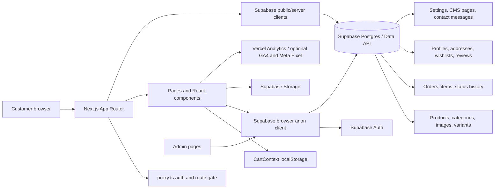

# Database, API, Integrations, and Data Flow

## Backend/API shape

The repository does not define a conventional application server/API layer. No `app/api/` route tree or server-action modules were found. The only app route handler is `app/auth/callback/route.ts` (GET). `proxy.ts` refreshes Supabase auth cookies and redirects protected paths.

Most reads and writes use Supabase directly:

- Browser auth/data client: `lib/supabase/client.ts` (`createBrowserClient`, anon URL/key).
- Public, cookie-free client: `lib/supabase/public.ts` (`@supabase/supabase-js`, session persistence off).
- Cookie-aware server client: `lib/supabase/server.ts` (`createServerClient`, Next `cookies()`).
- The public catalog services use a public client; account, admin, checkout and many interactive flows use the browser client.
- No service-role use was found in source. The local environment file contains a `SUPABASE_SERVICE_ROLE_KEY` variable name, but its value is not included here and source search found no reference.

## Database technology and verification boundary

Supabase SDK usage indicates a Supabase-hosted Postgres database and Supabase Auth/Storage. This is an inference from code dependencies and calls, not verification of the active hosted database. No migration, SQL schema, seed file, generated Supabase database type, or `supabase/` configuration directory was inventoried. Therefore actual column definitions, data types, constraints, foreign keys, indexes, triggers, RLS, and row contents are **unknown/unverified**.

The following entities are evidenced by `.from(...)` calls and source-level types. Column lists mean “queried or represented in checked-in code,” not a complete or authoritative SQL schema.

| Table/bucket | Columns/relations evidenced in source | Main access paths |
|---|---|---|
| `products` | `id`, `category_id`, `name`, `slug`, `short_description`, `description`, `ingredients`, `usage_instructions`, `storage_instructions`, `shelf_life`, `suitable_for`, `warnings`, `video_url`, `price`, `compare_at_price`, `sku`, `stock`, `low_stock_threshold`, `is_active`, `is_featured`, `rating_avg`, `rating_count`, `created_at`, `updated_at` | Public listing/detail/search; admin CRUD and counts; inventory; order price checks; review rating updates |
| `categories` | `id`, `name`, `slug`, `description`, `image_url`, `is_active`, `sort_order`, `created_at`, `updated_at` | Public category/listing/sitemap; admin CRUD |
| `product_images` | `product_id`, `url`, `alt`, `sort_order` | Joined with product queries; admin writes; Storage helper supplies public image URL |
| `product_variants` | `id`, `product_id`, `name`, `price`, `compare_at_price`, `stock`, `sku`, `sort_order` | Product detail; checkout price/stock checks; inventory |
| `orders` | `id`, `order_number`, `user_id`, `customer_name`, `customer_name_urdu`, `customer_phone`, `customer_email`, `shipping_address`, `shipping_address_urdu`, `shipping_city`, `shipping_city_urdu`, `shipping_state`, `shipping_state_urdu`, `shipping_postal_code`, `shipping_country`, `subtotal`, `shipping_fee`, `discount`, `total`, `payment_method`, `status`, `coupon_code`, `notes`, `created_at`, `updated_at` | Checkout insert; customer order history; order success/tracking reads; admin dashboard/list/status updates |
| `order_items` | `id`, `order_id`, `product_id`, `variant_id`, `product_name`, `variant_name`, `price`, `quantity`, `subtotal`, optional `image_url` in type | Insert after order; nested order reads; review purchase check; admin order detail |
| `order_status_history` | `order_id`, `status`, `note`, `created_at` (history row fields represented in tracking page) | Insert on order creation/status update; order tracking reads |
| `profiles` | `id`, `full_name`, `phone`, `avatar_url`, `created_at`, `updated_at` (some query paths use subsets) | Account profile; admin customer list; review name source; dashboard count |
| `addresses` | `id`, `user_id`, `full_name`, `phone`, `street`, `city`, `state`, `postal_code`, `country`, `is_default`, `created_at`, `updated_at` | Account address CRUD and checkout autofill |
| `admin_users` | `id` | Proxy, admin layout/login and `isAdmin` checks |
| `reviews` | `id`, `product_id`, `user_id`, `rating`, `title`, `body`, `is_approved`, `customer_name`, `created_at` | Public approved reviews; customer submit/eligibility; admin approval/deletion |
| `wishlists` | `id`, `user_id` | Signed-in wishlist get/create |
| `wishlist_items` | `wishlist_id`, `product_id` | Signed-in wishlist add/remove/list |
| `contact_messages` | `id`, `name`, `email`, `phone`, `subject`, `message`, `status`, `created_at`, `updated_at` | Public message insert; admin inbox/status/delete |
| `site_settings` | `key`, `value`; order flow also selects `shipping_fee`, `free_shipping_threshold` | Settings context, admin settings, checkout/order totals |
| `pages` | `id`, `slug`, `title`, `content`, `updated_at` | Admin CMS service |
| Supabase Storage `product-images` | File path/uploaded object; public URL generated by SDK | Admin product-image upload/delete; remote image allowlist includes Supabase public storage URLs |

### Relationships indicated by query shape/types

- Product to category via `products.category_id`.
- Product to product images/variants via `product_id`.
- Order to order items and status history via `order_id`.
- Order to optional authenticated user via `user_id`.
- Order item to product and optional variant via IDs.
- Review to product and authenticated user.
- Wishlist to user; wishlist item to wishlist/product.
- Profile and address rows associate to user by `id` / `user_id`.

These relationships are based on source-level joins and filters; foreign key constraints and cascade behavior are unknown.

## API/endpoints

| Endpoint/surface | Behavior | Notes |
|---|---|---|
| `GET /auth/callback` | Reads auth `code` and optional `next`, exchanges code for a Supabase session, redirects to destination or `/login?error=auth_failed` | It is the only first-party route handler found. |
| `proxy.ts` | Applies to most non-static paths, refreshes Supabase auth cookies for selected protected prefixes, checks admin membership and redirects | Checks `/admin*`, `/account*`, `/wishlist*`, and `/checkout*`; guest checkout conflict is documented in the issues report. |
| Supabase REST/Auth/Storage | Direct client SDK operations against configured Supabase project | No repository-defined API contract, server-side order endpoint, mail endpoint, or payment endpoint found. |

## Service/data-access modules

- `services/products/getProducts.ts`, `getProduct.ts`, `searchProducts.ts`: public catalog lookup, filters and search.
- `services/products/inventoryService.ts`: check, decrement, restore, and low-stock listing.
- `services/orders/orderService.ts`: current-user lookup; price/settings checks; order and line-item inserts; inventory updates; history insert; order reads.
- `services/auth/authService.ts`: Supabase Auth email/password flows, reset, sign-out and admin lookup.
- `services/profile/profileService.ts`: profile/address reads and writes.
- `services/reviews/reviewService.ts`: review read/eligibility/insert.
- `services/wishlist/wishlistService.ts`: user-bound wishlist rows.
- `services/contact/contactService.ts`: contact insert and admin inbox operations.
- `services/settings/settingsService.ts`: settings reads/writes and client-side shipping calculation.
- `services/admin/*`: dashboard, products, categories, orders, customers, reviews, CMS, notifications and storage.

## Checkout data flow

1. Product cards/details read product prices and stock from Supabase and create browser cart items.
2. `CartContext` persists item IDs, display names, client prices, quantity and image URL in localStorage.
3. Checkout collects customer/shipping fields and may autofill from profile/address.
4. `createOrder()` is imported by the client checkout page and creates the browser Supabase client. Its price lookup and stock check therefore run in browser code, despite its “server-side price validation” comment.
5. It calculates totals using fetched product/variant prices and site shipping settings, writes an `orders` row, then `order_items`, reduces stock and writes status history.
6. Order success and tracking pages query order records using order number. Customer account history filters by authenticated `user_id`; admin pages read/update orders via browser Supabase client.
7. GA4/Meta purchase tracking is called after order-success lookup when the relevant browser integrations are available.

`order_items`, stock reduction and history writes are not handled as one transaction in this client service. The source logs some follow-up errors but still returns an order-success response.

## External services and integrations

- **Supabase:** Auth, Postgres data API, cookie-based SSR support, Storage.
- **Vercel:** Analytics and Speed Insights components imported by root layout.
- **Google Analytics 4:** `GoogleAnalytics` component rendered when `NEXT_PUBLIC_GA_ID` is set; e-commerce event functions exist.
- **Meta Pixel:** `MetaPixel.tsx` conditionally initializes from `NEXT_PUBLIC_META_PIXEL_ID`; page-view and e-commerce events are implemented.
- **Fonts/images:** Google Fonts, Fontshare, Unsplash remote image, `placehold.co`, and Supabase public storage hosts are configured/referenced.
- **No source evidence found for:** transactional payment provider, courier/label API, email delivery provider, CRM, newsletter provider, push notifications, or coupon platform.

## Environment names (values withheld)

Names read from `.env.local`: `NEXT_PUBLIC_SUPABASE_URL`, `NEXT_PUBLIC_SUPABASE_ANON_KEY`, `SUPABASE_SERVICE_ROLE_KEY`, `NEXT_PUBLIC_SITE_URL`. Source additionally references `NEXT_PUBLIC_GA_ID` and `NEXT_PUBLIC_META_PIXEL_ID`, whose local values/configuration were not established. No values are reproduced.

## Mermaid data-flow diagram

## Data/security boundary

The checked-in source does not prove any RLS policy. Client-side route guards and admin UI checks are not substitutes for table/storage policies. Verify anonymous and authenticated read/write permissions for every entity, especially admin mutations, guest order creation, order lookup, contact submissions and Storage uploads. Do not use the service-role key in a client bundle.
